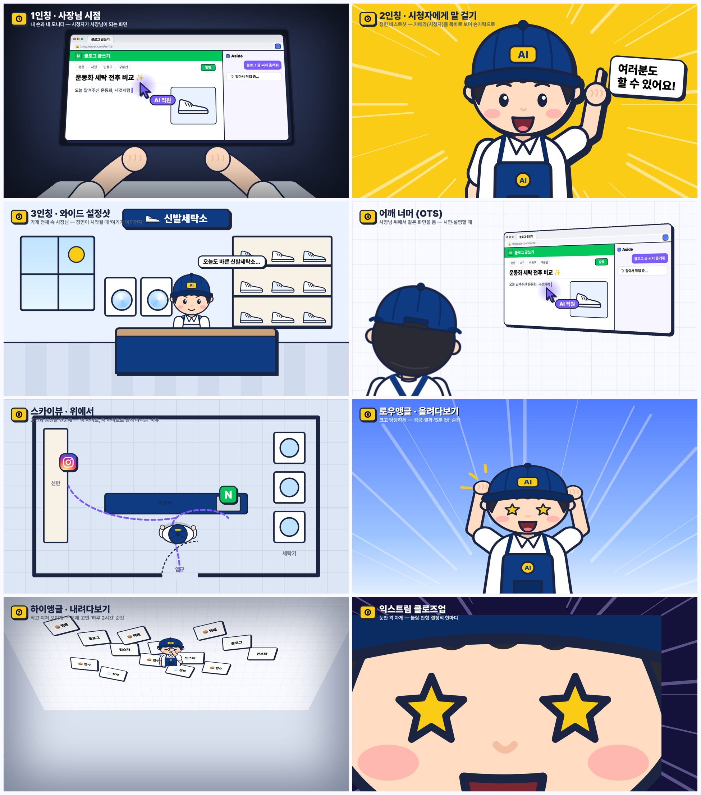

# 카메라 시점 기획: "사장님을 찍는 가상 카메라"

## 핵심 아이디어
모션그래픽이지만 **진짜 촬영 현장처럼 카메라 위치가 있다고 생각하고** 화면을 짠다.
같은 내용도 "누구의 눈으로 보느냐"에 따라 느낌이 달라진다.

| 시점 | 시청자의 위치 | 주는 느낌 |
|---|---|---|
| 1인칭 | 사장님 몸 안 (사장님 눈) | "내가 직접 하는 것 같다" → 따라 하고 싶게 |
| 2인칭 | 사장님 맞은편 (대화 상대) | "나한테 말하네" → 신뢰·친근감 |
| 3인칭 | 가게 안 관찰자 | "이런 가게구나" → 상황 이해 |
| 스카이뷰 | 천장 위 | "전체가 보인다" → 정리·구조 |

## 시점 8종 (샘플: `Angle1`~`Angle8` 컴포지션)
| # | 시점 | 화면 구성 | 이럴 때 쓴다 |
|---|---|---|---|
| ① | **1인칭 (사장님 시점)** | 화면 아래에서 내 두 손 + 내 모니터, 가장자리 어둡게 | 직접 해보는 시연, "제가 이렇게 시켰어요" |
| ② | **2인칭 (말 걸기)** | 정면 바스트샷, 카메라를 똑바로 보며 손가락으로 가리킴 | 팁, 주의사항, "여러분도 할 수 있어요", 엔딩 질문 |
| ③ | **3인칭 와이드 (설정샷)** | 가게 세트 전체 속 작은 사장님 | 장면·파트의 시작, "여기가 어디인지" |
| ④ | **어깨 너머 (OTS)** | 앞쪽에 사장님 뒷모습(살짝 흐림), 뒤쪽에 모니터 | 시연 설명, AI가 일하는 걸 함께 지켜볼 때 |
| ⑤ | **스카이뷰 (위에서)** | 가게 평면도 + 위에서 본 사장님 + 동선 점선 | 순서·흐름 정리, "사이트를 옮겨 다니는" 비유 |
| ⑥ | **로우앵글 (올려다보기)** | 아래에서 올려다본 큰 사장님, 하늘 배경 | 성공·결과·숫자 공개 ("5분 컷!") |
| ⑦ | **하이앵글 (내려다보기)** | 위에서 내려다본 작은 사장님, 일거리 더미, 가장자리 어둡게 | 문제·고민·피곤함 ("하루 2시간") |
| ⑧ | **익스트림 클로즈업** | 눈만 화면에 꽉 차게 | 놀람·반함·결정적 한마디 |

## 감정 = 앵글 (규칙)
- **문제/고민** → ⑦ 하이앵글 (작아 보이게) + ⑤ 스카이뷰 (복잡한 동선)
- **해결/성공** → ⑥ 로우앵글 (커 보이게) + ⑧ 클로즈업 리액션
- **설명/팁** → ② 2인칭 (시청자 눈을 봄)
- **시연** → ④ 어깨 너머 → ① 1인칭 (점점 사장님 안으로 들어감)
- **장소·파트 시작** → ③ 와이드
- 한 영상에 **최소 5가지 시점**을 쓰고, **같은 시점을 연속 2번** 쓰지 않는다
- 캐릭터 크기도 비트마다 바꾼다: 아주 작게(스카이뷰) → 상반신(와이드) → 바스트(2인칭) → 얼굴(클로즈업) → 눈(익스트림)

## 시점 사이 전환 (카메라가 움직이는 것처럼)
| 전환 | 방법 | 쓰임 |
|---|---|---|
| 스카이뷰 → 3인칭 와이드 | **크레인 다운**: 천장에서 내려오며 화면이 눕혀졌다 세워짐 (rotateX 60° → 0°) | 파트 시작 |
| 3인칭 와이드 → 어깨 너머 | **돌리 인 + 오빗**: 사장님 쪽으로 다가가며 뒤로 돌아감 | 시연 시작 |
| 어깨 너머 → 1인칭 | **줌 스루**: 모니터 안으로 쑥 들어가며 손이 화면 아래에서 올라옴 | "제가 시켜볼게요" |
| 1인칭 → 2인칭 | **고개 돌리기 휙**: 빠른 가로 휙 + 블러 후 정면 얼굴 | "보셨죠?" |
| 하이앵글 → 로우앵글 | **스윙**: 카메라가 아래로 크게 휘돌며 위아래가 뒤집힘 | 문제 → 해결 반전 |
| 무엇이든 → 익스트림 클로즈업 | **스냅 줌**: 3프레임 만에 눈으로 확 당김 + 흔들림 | 강조 |

## 실험 #003 적용 예시 ("가게 사장님이 AI를 쓰면 달라지는 점")
| 파트 | 시점 흐름 |
|---|---|
| 훅 | ⑧ 눈 클로즈업 → 스냅 줌 아웃 → ⑥ 로우앵글 "이렇게 달라졌어요" |
| AI 쓰기 전 | ⑤ 스카이뷰(복잡한 동선) → 크레인 다운 → ⑦ 하이앵글(일에 파묻힌 사장님) |
| AI 쓴 뒤 | ③ 와이드(여유로운 가게) → 돌리 인 → ④ 어깨 너머 → 줌 스루 → ① 1인칭 |
| 달라진 점 정리 | ② 2인칭 정면으로 하나씩 |
| 엔딩 | ③ 와이드에서 손 흔들기 → 크레인 업 → ⑤ 스카이뷰로 끝 |

## 이미 만든 것 / 다음에 만들 것
**만든 것**
- `BossBack` 뒷모습, `BossTop` 위에서 본 모습, `PovHands` 1인칭 손 (`src/character/BossViews.tsx`)
- `Boss crop="bust"` 2인칭 바스트샷, `crop="eyes"` 익스트림 클로즈업
- `ShopInterior` 가게 세트, `ShopFloorPlan` 가게 평면도 (`src/sets/Shop.tsx`)
- 시점 샘플 8종 (`src/compositions/CameraAngles.tsx`)

**다음에 만들 것**
- `CameraRig`: 앞·중간·뒤 레이어에 깊이를 주고 카메라가 움직이면 서로 다른 속도로 움직이는 2.5D 패럴랙스
- 시점 전환 컴포넌트: 크레인, 돌리 인/오빗, 줌 스루, 스윙
- 옆모습 (3인칭 옆에서 걷기·앉기)
- 걷기 동작 (스카이뷰·와이드에서 가게 안을 걸어 다니기)
