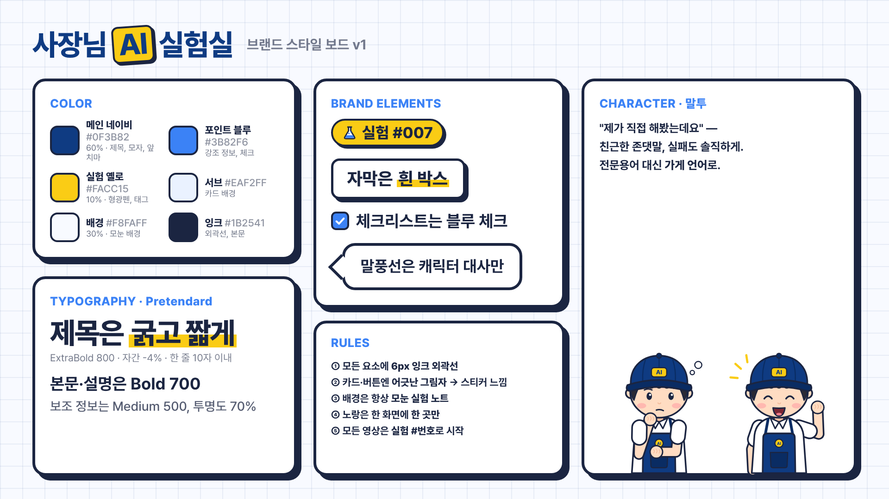

# 사장님 AI 실험실 — 브랜드 & 영상 스타일 가이드 v1

## 1. 브랜드 콘셉트: "사장님의 실험 노트"
- **모든 영상은 하나의 '실험'** 입니다. 영상과 썸네일에는 항상 `실험 #001`처럼 번호를 붙입니다. 시리즈처럼 쌓이고, 다음 편을 기다리게 만듭니다.
- **배경은 모눈종이 실험 노트**입니다. 이 채널만의 시각적 서명이에요.
- **캐릭터와 UI 모두 굵은 잉크 외곽선(6px)과 어긋난 그림자**를 씁니다. 스티커 같은 느낌으로 통일합니다.

## 2. 말투 (Tone & Voice)
| 이렇게 | 이렇게 안 함 |
|---|---|
| "제가 직접 해봤는데요" | "AI 활용법을 알려드리겠습니다" |
| 친근한 존댓말 | 반말, 과한 유행어 |
| 가게 언어: "손님 응대", "리뷰 답글", "마감 정산" | 전문용어: "프롬프트 엔지니어링", "LLM" (쓸 땐 바로 풀어서) |
| 실패도 솔직하게: "이건 별로였어요" | 무조건 "대박", "혁명" |
| 숫자로 보여주기: "5분 → 30초" | "엄청 빨라져요" |

## 3. 컬러
| 이름 | 값 | 비중·용도 |
|---|---|---|
| 메인 네이비 | `#0F3B82` | 약 60%: 제목, 모자, 앞치마, 다크 배경 |
| 배경 | `#F8FAFF` | 약 30%: 밝은 모눈 배경 |
| 실험 옐로 | `#FACC15` | 약 10%: 형광펜, 실험 태그. **한 화면에 한 곳만** |
| 포인트 블루 | `#3B82F6` | 체크, 사용자 채팅 말풍선, 소제목 |
| 서브 | `#EAF2FF` | 카드 안쪽, AI 답변 말풍선 |
| 잉크 | `#1B2541` | 외곽선, 본문 글자 |

## 4. 타이포그래피 (Pretendard)
- 제목: ExtraBold 800, 자간 -4%, **한 줄 10자 이내**, 강조어 1개에 노란 형광펜
- 본문·체크리스트: Bold 700
- 보조 정보: Medium 500, 투명도 70%

## 5. 채널 아트 (업로드용 파일: `docs/brand/`)
| 항목 | 파일 | 규격 |
|---|---|---|
| 프로필 사진 | `ProfileImage.png` | 800×800 (원형으로 잘림) |
| 배너 | `Banner.png` | 2560×1440, 중요한 내용은 가운데 1546×423 안 (`BannerSafeArea.png` 참고) |
| 워터마크 | `Watermark.png` | 150×150 (YouTube Studio → 맞춤설정 → 브랜딩) |
| 썸네일 | `ThumbnailA/B.png` | 1280×720 |

### 썸네일 규칙
1. 왼쪽 위에 `실험 #번호`
2. 제목은 3줄, 한 줄 2~5자. 가운데 줄 = 노란 박스 강조
3. 오른쪽엔 캐릭터를 크게. **표정이 곧 감정**입니다 (놀람 = 의외의 결과, 걱정 = 주의/실패, 신남 = 성공)
4. 배경은 **밝은 모눈(성공·방법)** / **네이비 모눈(주의·솔직후기)** 두 가지만
5. 숫자 결과가 있으면 오른쪽 위 스티커로 (`5분 → 30초`)

## 6. 영상 스타일
### 쇼츠 1080×1920 (`ShortsFrame.png`, `ShortsSafeArea.png`)
- 위에서부터 **실험 태그 → 제목 → 콘텐츠 카드 → 자막 → 캐릭터+말풍선**
- 아래 380px, 오른쪽 140px는 유튜브 버튼이 덮으므로 글자 금지 (캐릭터 몸통은 괜찮음)

### 롱폼 1920×1080 (`LongformFrame.png`)
- 왼쪽 2/3 = 콘텐츠 카드 (AI 채팅 화면, 체크리스트, 비교표)
- 오른쪽 아래 = 캐릭터 고정 자리, 오른쪽 위 = 작은 워드마크
- 자막은 콘텐츠 카드 아래 가운데

### 공통 요소 (`src/components/brand.tsx`)
| 요소 | 컴포넌트 | 규칙 |
|---|---|---|
| 배경 | `GridBg` | light / navy 두 가지 |
| 카드 | `Card` | 흰색, 6px 외곽선, 오른쪽 아래 그림자 |
| 자막 | `Caption` | 흰 박스 + 굵은 글씨, 강조어는 `Mark` |
| 실험 번호 | `ExperimentTag` | 첫 장면과 썸네일에 필수 |
| 체크리스트 | `CheckItem` | 블루 체크 |
| 말풍선 | `Bubble` | 캐릭터 대사에만 사용 |
| 로고 | `Wordmark` | 사장님 [AI] 실험실 |

### 모션 규칙
- 등장: `spring` 팝업 (살짝 튀어오름), 요소당 0.3~0.5초, 순서대로 0.2초 간격
- 캐릭터: 계속 미세하게 위아래로 움직이고 2~3초마다 깜빡임. 말할 때 입 움직임
- 장면 전환: 네이비 패널이 사선으로 쓸고 지나감 (`WipeTransition`, 0.5초)
- 인트로: 2초 (`Intro.mp4`). 캐릭터 등장 → 로고 팝 → "오늘도 직접 실험해봤습니다"
- 하지 않는 것: 회전·줌 남발, 3D, 글리치, 여러 색 그라데이션
